# ScanDiff

**Tamper-evident 3D evidence of an item's condition at handoff.** Measured, not argued. Built at Cal Hacks 13.0.

- Website: [scandiff.us](https://scandiff.us)
- Diff engine API: [engine.scandiff.us/docs](https://engine.scandiff.us/docs)
- Try it without a phone: the [mug demo](https://scandiff.us/item/mug-001) and the [rental car demo](https://scandiff.us/item/car-001) run in the browser on mock data, and the [demo checkout](https://scandiff.us/checkout/mug-001) walks through hold, accept and dispute.

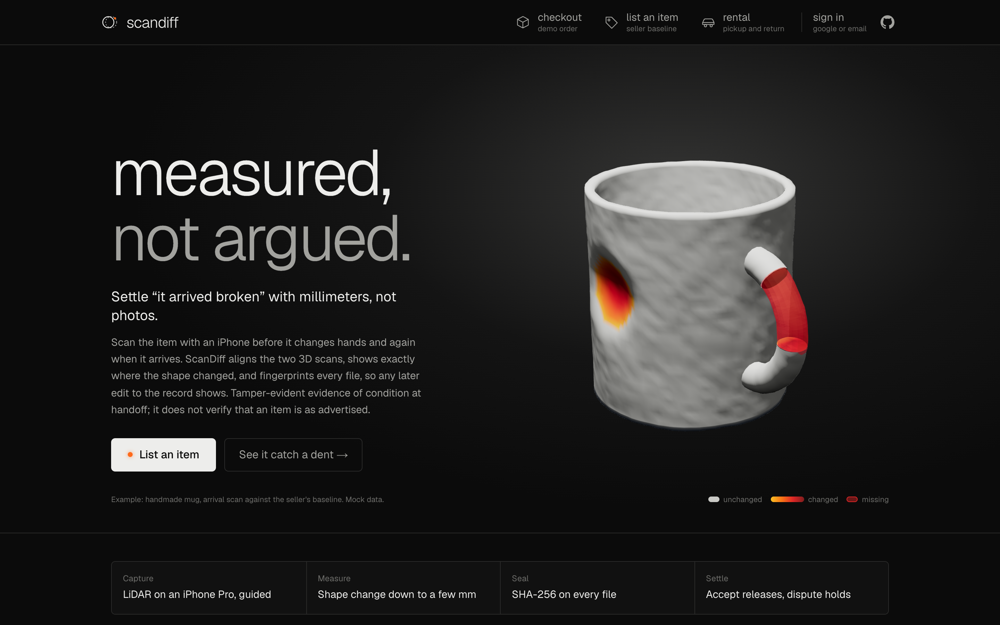

## The problem

Every time a physical item changes hands, someone has to trust the other side about its condition:

- **Online resale.** A buyer says the item arrived broken. The seller says it left in perfect shape. Both have a few photos, and neither can prove when the damage happened.
- **Rentals.** A rented camera, bike or car comes back, and the owner finds a dent. Was it there before? The check-out photos were taken quickly, from a few angles, in different light.
- **Shipping and returns.** A returned item comes back damaged, or the wrong item comes back. The platform has to settle the claim from two stories and a handful of pictures.

Photos are weak evidence. They only show the angles someone chose, they flatten depth, so a 3 mm dent can vanish under the wrong light, and two sets of photos can't be compared objectively. Nothing ties a photo to the moment of handoff either, and today anyone can generate a photo of damage that never happened. So disputes come down to one person's word against another's.

## What ScanDiff does

ScanDiff replaces "trust me" with a measured before-and-after record of the item's shape: one scan when an item leaves, one when it arrives, and both have to match before money moves.

1. **List.** The seller lists the item on the website or in the app. It gets an item ID (`mug-002`) and two QR codes: the seller's baseline scan and the buyer's check-in.
2. **Baseline.** Before packing, the seller scans the item with a LiDAR iPhone. The app runs a checklist, finds the object, guides two orbits and an optional bottom pass, and builds a textured 3D model on the phone. It keeps 10 sharp key photos with their camera poses, fingerprints every file with SHA-256, and uploads the scan.
3. **Check-in.** The buyer pays in the demo checkout; the payment is held. When the parcel arrives, they scan the check-in QR code. It opens the app on the right item and adds their account to it, and they do a quick one-orbit scan.
4. **Comparison.** The engine verifies every fingerprint and aligns the two scans: globally first (FPFH features with RANSAC), then refined with ICP. It measures signed point-to-surface distances against the scanner's noise floor and groups the changes into numbered regions. A vision model (Claude) looks at before and after photo crops of each region and labels it a dent, a missing part, a scuff or normal wear.
5. **Evidence.** The phone and the website both show the verdict with its confidence and reason, a 3D heat map (blue for dents, red for added material, gray for unchanged), the histogram and the findings. A printable evidence page lists both scans' fingerprints.
6. **Decision.** The buyer accepts or disputes, on the phone or on the website. Supabase Realtime updates the checkout instantly: accept releases the held payment. A dispute keeps it held and records a refund in Capital One's Nessie sandbox.

What it is and isn't:

- It is **tamper-evident evidence of condition at handoff**. It does not prove that an item is as advertised.
- LiDAR measures **shape, not color**: scuffs and stains with no depth are not detected from the geometry.
- Only surface that **both scans saw** is compared. Areas only one scan saw are reported as "no data", never as damage.
- Payments are a **demo**. No real money is held or moved; the refund is a Nessie sandbox deposit.

## Screenshots

| | |
|---|---|
| 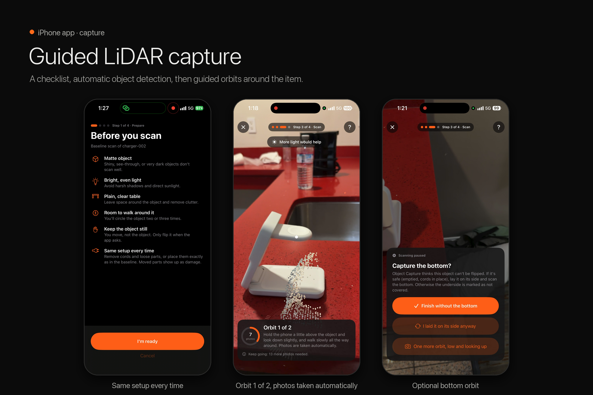 | 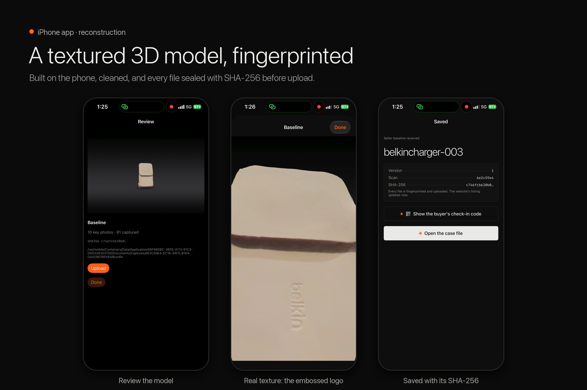 |
| **Guided capture** on the iPhone | **Textured model**, sealed with SHA-256 |
| 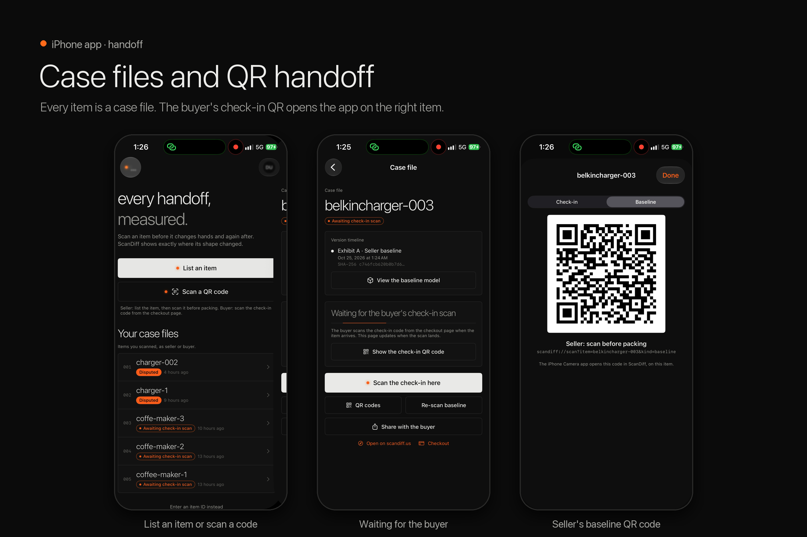 | 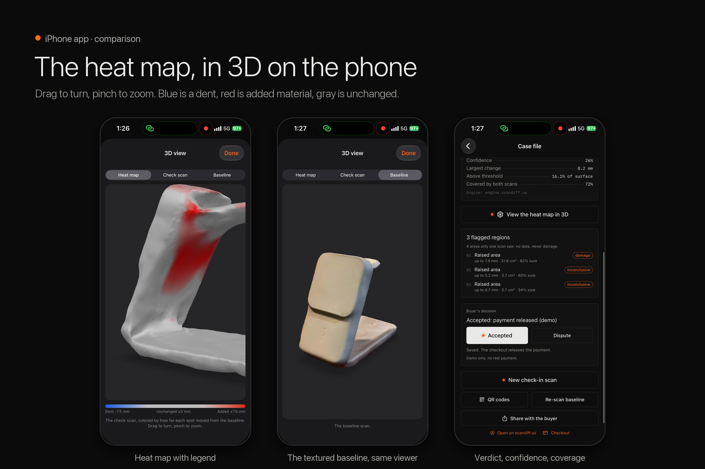 |
| **Case files and QR handoff** | **3D heat map** on the phone |
| 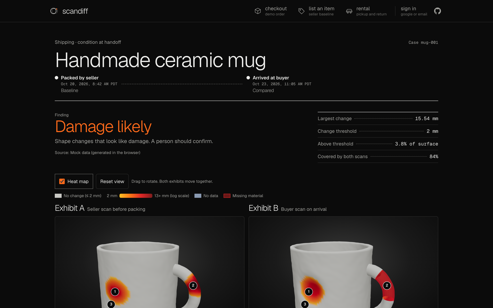 | 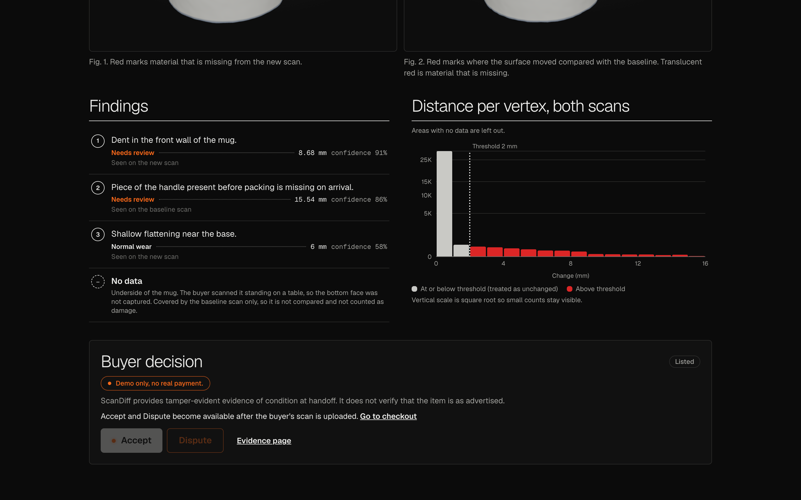 |
| **Comparison** on scandiff.us | **Findings and histogram** |
| 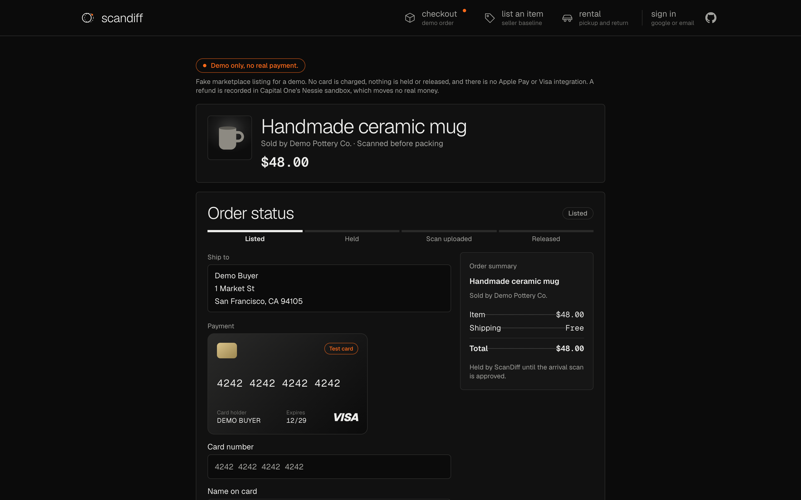 | 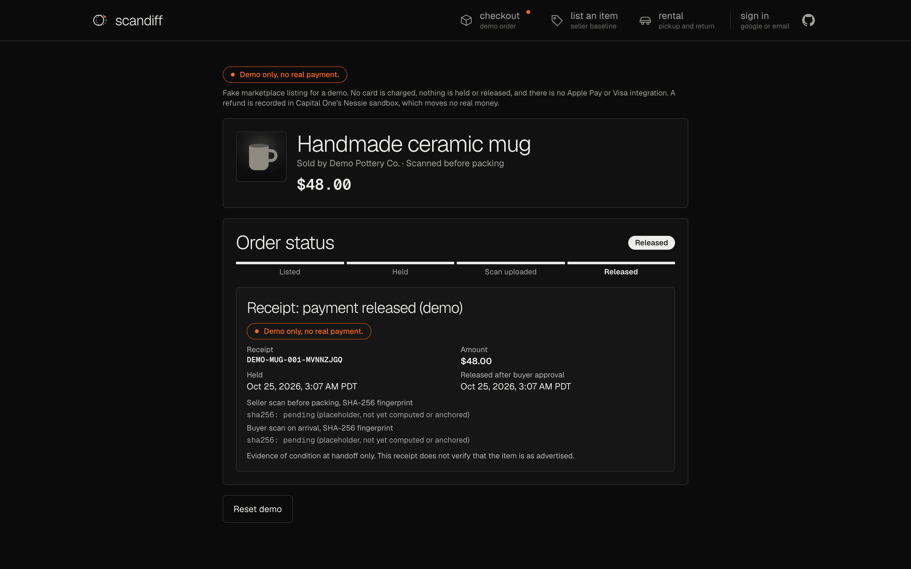 |
| **Demo checkout**, payment held until check-in | **Accept** releases the payment |
| 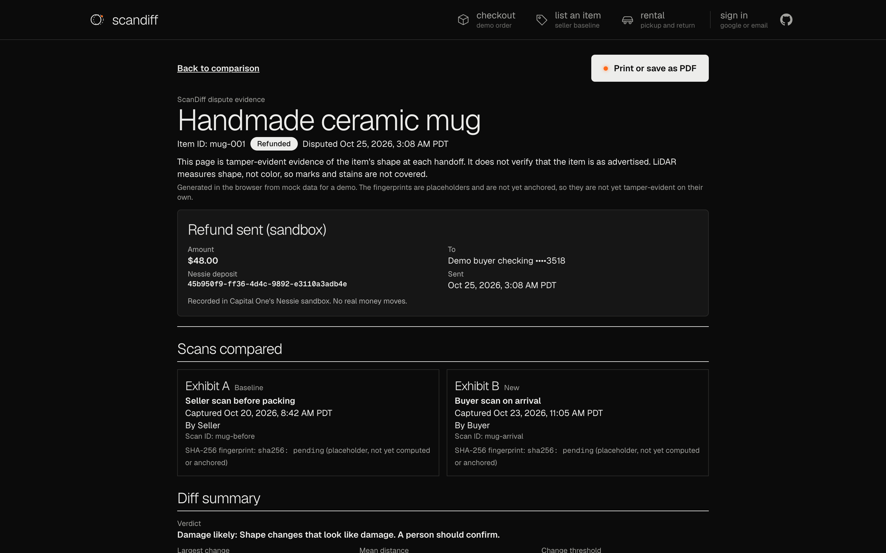 | 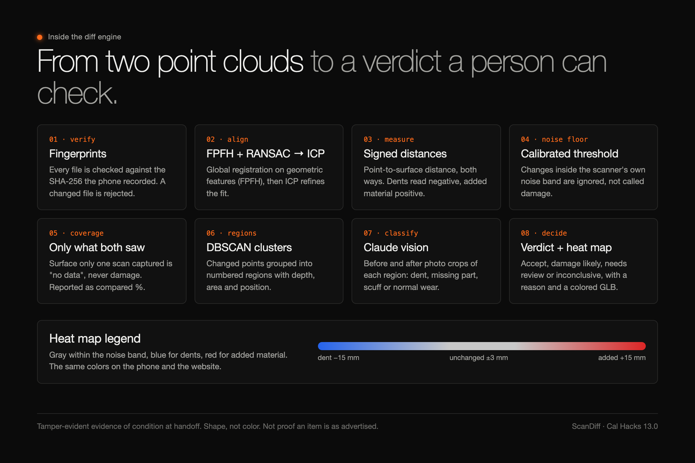 |
| **Dispute**: evidence page and Nessie refund | **Inside the engine** |

Every image is in [`media/devpost/gallery/`](media/devpost/gallery/), numbered in the order they tell the story.

## How it fits together

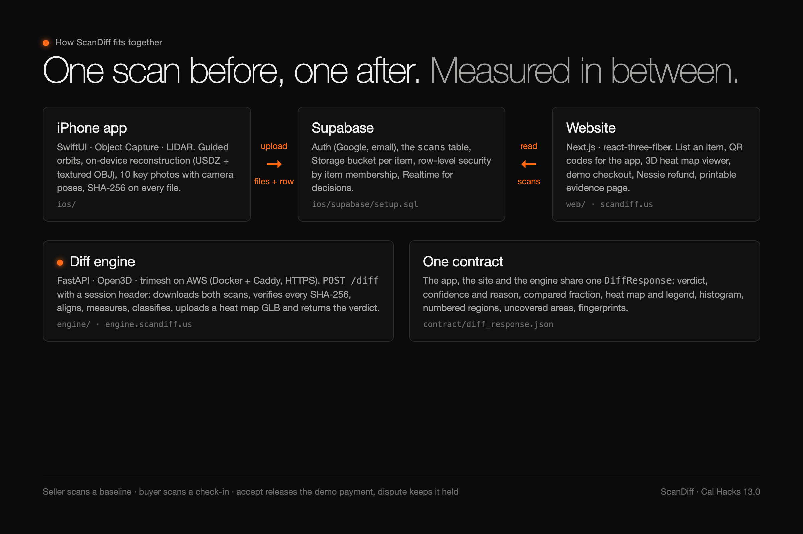

```
iPhone app (ios/)  ──upload──▶  Supabase (auth, scans table, Storage, Realtime)  ◀──read──  Website (web/)
        │                                        ▲                                          │
        └────────────── POST /diff ──▶  Engine (engine/, AWS)  ◀──── POST /diff ──────────────┘
```

| Folder | What it is | Built with |
|---|---|---|
| [`ios/`](ios/README.md) | Capture app: guided LiDAR capture, on-device reconstruction, mesh cleanup, key photos with poses, SHA-256 fingerprints, upload, case files, QR codes, in-app 3D heat map, Accept / Dispute. | SwiftUI, RealityKit Object Capture, ModelIO, VisionKit, supabase-swift, Google Sign-In |
| `engine/` | Diff engine: fingerprint checks, alignment, signed point-to-surface distances, noise floor, coverage, change regions, vision classification, heat map GLB and verdict. Upload format: [`engine/UPLOAD_FORMAT.md`](engine/UPLOAD_FORMAT.md). | Python, FastAPI, Open3D, trimesh, scikit-learn, Claude, Docker + Caddy on AWS |
| [`web/`](web/README.md) | Site at scandiff.us: list an item, QR codes for the app, comparison viewer, live demo checkout, Nessie refunds, printable evidence page. | Next.js, React Three Fiber, Supabase, Capital One Nessie, Vercel |
| [`contract/`](contract/README.md) | The `POST /diff` response contract shared by the engine, the app and the website. | JSON Schema, generated TypeScript |
| [`ios/supabase/`](ios/supabase/setup.sql) | Database setup: scans, items and members, row-level security (each item is visible only to its owner and the people it was shared with), Storage rules, Realtime. | Postgres, Supabase |

## Try it

- **In the browser:** open [scandiff.us](https://scandiff.us). The mug and rental car demos work signed out and offline from the engine. Sign in with Google or email to see real items scanned with the app.
- **With an iPhone:** the app needs an iPhone Pro with LiDAR (12 Pro or later). Build it from [`ios/`](ios/README.md) with Xcode, sign in, tap **List an item**, scan, then scan the check-in QR code from a second account.
- **The engine:** `POST https://engine.scandiff.us/diff` with two scan IDs, after `GET /health` for a session ID. The interactive docs are at [engine.scandiff.us/docs](https://engine.scandiff.us/docs).

## What's next

The same scan-in, scan-out check fits anything that is shared or handed over: rental cars, hotel rooms and apartments at move-out, equipment rentals, returns and insurance claims. Next is an SDK, so marketplaces and shipping platforms can build scan-based payments and returns into their own apps.

## Team

- Adithya Sripada: diff engine
- Koushik Jandhyala: iPhone app and Supabase
- Keshav Pillarisetti: website
